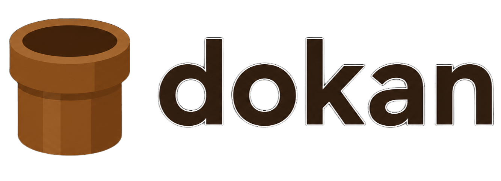

<p align="center">
  
</p>

<p align="center">
  AWS Systems Manager Session Manager 経由の接続を簡単にする、RDS 向けポートフォワード CLI
</p>

<p align="center">
  <a href="https://github.com/tomozo6/dokan/releases"></a>
  <a href="https://github.com/tomozo6/dokan/blob/main/LICENSE"></a>
  <a href="https://go.dev/"></a>
</p>

# dokan

## 📖 dokanとは

`dokan` は、踏み台 EC2 を経由した RDS への SSM ポートフォワードを対話形式で実行する CLI です。

- AWS マネジメントコンソールを開かずに接続準備できる
- 踏み台 EC2 と接続先 DB クラスタを対話で選択できる
- `writer` / `reader` の接続先をフラグで切り替えられる

## ⚡ クイックスタート

```bash
brew install tomozo6/tap/dokan
dokan
```

実行後、対話形式で以下を選択します。

1. 踏み台 EC2
2. 接続先 DB クラスタ

デフォルトでは `reader` エンドポイントへ接続し、ローカルポートは DB ポートと同じ番号になります。

## 📦 インストール

### Homebrew (macOS / Linux)

```bash
brew install tomozo6/tap/dokan
```

### Scoop (Windows PowerShell)

```powershell
scoop bucket add tomozo6 https://github.com/tomozo6/scoop-bucket
scoop install dokan
```

### バイナリ

[Releases](https://github.com/tomozo6/dokan/releases) からダウンロードできます。

## 🛠️ 使い方

詳細は `dokan [command] --help` を参照してください。

### 基本コマンド

```bash
dokan
```

踏み台 EC2 と DB クラスタを選択してポートフォワードします。

選択画面では、↑↓ または Tab で候補を移動し、Enter で確定します。
文字を入力すると、大文字小文字を区別しない部分一致で候補を絞り込めます。
Backspace で1文字削除、Ctrl+U で検索をクリア、Esc または Ctrl+C でキャンセルできます。
候補は最大7件ずつスクロール表示されます。

### 主要オプション

```bash
# writer インスタンスへトンネリング
dokan --writer

# AWS プロファイルを指定
dokan --profile stg

# ローカルポートを指定
dokan --port 3333
```

### EC2へログイン

```bash
dokan ec2login
```

対話形式で EC2 を選択し、SSM Session Manager でログインします。
(`bash` でログインするため、接続先に `bash` が必要です)

## 開発環境

Go のバージョンは [mise](https://mise.jdx.dev/) の `mise.toml` で管理しています。
mise をインストールしたうえで、リポジトリのルートで以下を実行してください。

```bash
mise trust
mise install
mise exec -- go version
mise exec -- go test ./...
mise exec -- go build ./...
```

シェルで mise を有効化している場合は、`go` コマンドを直接実行できます。
リリース CI も同じ `mise.toml` を使用します。

Go を更新するときは、`mise.toml` の固定バージョンと `go.mod` の最低バージョン、
この README のバッジを揃えて更新してください。

## 🔐 AWS 認証情報の参照順

`dokan` は次の優先順で AWS プロファイルを解決します。

1. `--profile` フラグ
2. `AWS_PROFILE` 環境変数
3. `AWS_DEFAULT_PROFILE` 環境変数
4. AWS SDK のデフォルト認証チェーン

PowerShell 例:

```powershell
$env:AWS_DEFAULT_PROFILE = "your-profile"
dokan
```

## ✅ 前提条件

### Session Manager Plugin

`dokan` の利用には、AWS の Session Manager Plugin が必要です。

[AWS CLI 用 Session Manager プラグインのインストール手順](https://docs.aws.amazon.com/ja_jp/systems-manager/latest/userguide/session-manager-working-with-install-plugin.html)

### IAM 権限

実行ユーザーには、少なくとも以下が必要です。

- `ec2:DescribeInstances`
- `rds:DescribeDBClusters`
- `ssm:StartSession`
- `ssm:TerminateSession`

最小構成のポリシー例:

```json
{
  "Version": "2012-10-17",
  "Statement": [
    {
      "Sid": "DescribeResources",
      "Effect": "Allow",
      "Action": [
        "ec2:DescribeInstances",
        "rds:DescribeDBClusters"
      ],
      "Resource": "*"
    },
    {
      "Sid": "StartSessionForBastionInstances",
      "Effect": "Allow",
      "Action": "ssm:StartSession",
      "Resource": [
        "arn:aws:ec2:ap-northeast-1:123456789012:instance/*",
        "arn:aws:ssm:ap-northeast-1::document/AWS-StartPortForwardingSessionToRemoteHost",
        "arn:aws:ssm:ap-northeast-1::document/AWS-StartInteractiveCommand"
      ]
    },
    {
      "Sid": "TerminateOwnSession",
      "Effect": "Allow",
      "Action": "ssm:TerminateSession",
      "Resource": "arn:aws:ssm:ap-northeast-1:123456789012:session/*"
    }
  ]
}
```

`ap-northeast-1` と `123456789012` は利用環境に合わせて置き換えてください。

### `ec2login` 利用時の補足

`dokan ec2login` の実行には、上記 IAM 権限に加えて接続先 EC2 側の SSM 要件も必要です。

- 接続先 EC2 が Systems Manager のマネージドノードとして認識されていること
- 接続先 EC2 のインスタンスロールに `AmazonSSMManagedInstanceCore` 相当の権限が付与されていること
